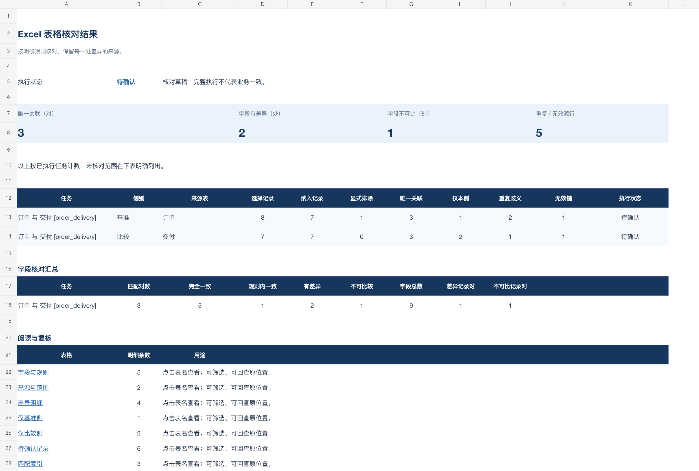

<p align="center">
  
</p>

<p align="center"></p>
<h1 align="center">Excel表格核对助手</h1>
<p align="center"><strong>让每一处表格差异，都能定位、解释和复核。</strong></p>
<p align="center">Excel Reconciliation Assistant<br>面向各行业与多种 Agent 客户端的表格核对 Skill</p>
<p align="center">
  <a href="https://github.com/zcjunblog/excel-reconciliation-assistant/releases/download/v0.1.4/excel-reconciliation-assistant-0.1.4.zip">标准 Skill</a> ·
  <a href="https://github.com/zcjunblog/excel-reconciliation-assistant/releases/download/v0.1.4/excel-reconciliation-assistant-workbuddy-0.1.4.zip">WorkBuddy 安装包</a> ·
  <a href="#工作流程">工作流程</a> ·
  <a href="#真实演示">真实演示</a> ·
  <a href="#快速开始">快速开始</a>
</p>

**Excel表格核对助手是一套面向业务表格复核的开源 Agent Skill。** 依据明确的业务编号、字段映射与比较规则，对 XLSX、CSV 数据进行核对，形成可筛选、可解释、可回查的结果工作簿与报告。

覆盖订单交付、库存盘点、报名签到、资产管理及清单版本核对等办公场景。由 Agent 整理任务与规则，确定性工具执行读取、关联、比较和文件生成。原始表格保持只读，每次交付独立保存；业务歧义和待确认范围始终可见。

<p align="center"><strong>规则明确</strong> · <strong>差异可追溯</strong> · <strong>原表只读</strong> · <strong>MIT 开源</strong></p>

## 快速开始

### 选择安装方式

| 使用方式 | 下载与安装 |
| --- | --- |
| WorkBuddy | 下载专用 ZIP，在客户端“添加技能 → 上传技能”导入，打开新任务调用 |
| 其他支持 Agent Skills 的客户端 | 下载标准 ZIP，将完整技能目录安装到客户端支持的位置；[查看安装指南](docs/installation.md) |
| 本地 Python | 克隆仓库后运行确定性 CLI；[查看本地示例](#本地运行与规则复用) |

使用前确认宿主具有文件读写、Python 3.9+ 和输出目录权限。需要 XLSX 时，在所选 Python 环境安装 `openpyxl>=3.1,<4`；可通过 `scripts/doctor.py --require-xlsx` 检查依赖。CSV 计算和 Markdown／JSON 交付可使用标准库。工具本身不要求模型 API 密钥。

可以这样提出任务：

> 核对这两份资产清单。按资产编号对应，比较领用人、数量和金额，金额绝对差额 0.01 以内视为容差内一致。编号保持原样，原表只读。生成 Excel、核对报告和待确认事项，保留原行定位。若字段或单位不明确，请列出需要确认的问题。

### 下载 v0.1.4

| 安装包 | 用途 |
| --- | --- |
| [下载标准 Skill ZIP](https://github.com/zcjunblog/excel-reconciliation-assistant/releases/download/v0.1.4/excel-reconciliation-assistant-0.1.4.zip) | 标准目录，适配具备文件执行能力的 Agent 客户端 |
| [下载 WorkBuddy ZIP](https://github.com/zcjunblog/excel-reconciliation-assistant/releases/download/v0.1.4/excel-reconciliation-assistant-workbuddy-0.1.4.zip) | 包含中英展示信息、三组快捷示例和市场目录适配 |

[全部发布文件](https://github.com/zcjunblog/excel-reconciliation-assistant/releases/tag/v0.1.4) · [SHA256SUMS](https://github.com/zcjunblog/excel-reconciliation-assistant/releases/download/v0.1.4/SHA256SUMS) · [逐资源清单](releases/0.1.4/manifest.json)

下载后按 SHA256SUMS 核对摘要，再解压或导入。两包均含 MIT 许可证、完整工具和四行业合成样例；区别为平台展示与样例目录适配，核对引擎和业务规则一致。

## 核心能力

| 业务中的常见问题 | 助手提供的支持 |
| --- | --- |
| 两张表的行序、列序不同 | 按唯一业务键或复合键关联，分别记录左右字段映射 |
| 有些记录只出现在一侧 | 分别列出两侧独有记录，保留原行位置 |
| 编号重复、为空或存在一对多关系 | 隔离相关原行，整理待确认事项，避免任意配对 |
| 编号含前导零或格式容易被转换 | 保留文本原文；`0007` 与 `7` 默认不同，规范化需明确规则 |
| 数量、金额或日期需要按口径比较 | 使用精确十进制、明确容差与单位/币种；日期解释和精度缺口保持可见 |
| 公式看似有值，实际缓存未确认 | 区分公式文本、已保存缓存与实际重算，保留缓存新鲜度限制 |
| 差异结论难以复核 | 记录文件、工作表、原行列、左右原值、差额与判定原因 |

支持同一工作簿中的两张表、不同文件的数据表，以及多个独立任务逐对执行。输入为 XLSX／CSV；交付为 XLSX、Markdown、JSON／JSONL。CSV 是输入格式，不生成 CSV 结果表。

## 适用场景

| 场景 | 典型核对任务 |
| --- | --- |
| 商贸与项目交付 | 按订单号、行号核对数量、金额与交付记录 |
| 库存与现场盘点 | 按商品编号、仓位核对台账、实盘与单位 |
| 培训、活动与报名 | 按报名编号核对名单、签到和字段变化 |
| 行政与资产管理 | 按资产编号核对领用人、数量、状态或价值 |
| 其他业务清单 | 在明确范围与字段含义后，复用相同规则结构 |

## 工作流程

| 阶段 | 处理内容 | 可以查看的结果 |
| --- | --- | --- |
| **01 · 资料与范围** | 登记已授权来源，选择工作表、表头、数据范围和排除行 | 来源登记、实际范围和原始摘要 |
| **02 · 规则准备** | 明确基准/比较侧、业务键、字段映射、类型、容差和单位 | 可保存、可复用的核对规则 |
| **03 · 结构预检** | 检查文件、表头、列映射、格式与范围；暴露规则缺口 | 预检报告与阻断说明 |
| **04 · 业务关联** | 按精确键关联唯一记录，隔离重复键和空键 | 全量匹配索引与逐侧行分类 |
| **05 · 字段核对** | 比较原值与规范化值，区分一致、规则内一致、差异及不可比 | 左右原值、差额、原因和来源坐标 |
| **06 · 文件交付** | 生成白蓝工作簿、报告、待确认事项与结构化工作资料 | 实际文件清单及逐文件 SHA-256 |
| **07 · 人工复核** | 回查原表，确认歧义；补充规则后另建版本重跑 | 旧版保留、新版结果与新的确认依据 |

**执行完整表示指定规则已执行完毕，仍可能存在业务差异。** 重复键、空键、不可比较字段和未生成格式会明确说明；业务处理由使用者结合原表确认。

## 真实演示

以下均为合成数据，由 0.1.0 核对引擎实际生成；0.1.4 保留相同业务逻辑。展示文件保留原始清单与摘要，可下载检查。

### 一份清单的数量与金额变化

基准清单与比较清单的行序不同，按资产编号精确对应。金额币种在原表中明确为 CNY，数量单位为台，差额方向固定为**比较侧减基准侧**。

| 编号 | 字段 | 基准值 | 比较值 | 差额 | 判定 |
| --- | --- | --- | --- | --- | --- |
| `0007` | 数量 | 10 | 8 | -2 | 有差异 |
| `0007` | 金额 | 100.00 | 89.75 | -10.25 | 有差异 |
| `0008` | 金额 | 0.10 | 0.30 | +0.20 | 有差异 |

2 对记录、6 次非键字段比较：3 处完全一致、3 处差异，执行状态为 `complete`。这份结果说明规则执行完整，业务仍有差异。

[基准原表](examples/release-cases/negative-delta/基准清单.csv) · [比较原表](examples/release-cases/negative-delta/比较清单.csv) · [明确规则](examples/release-cases/negative-delta/rules.json) · [结果工作簿](examples/showcase-v1/negative-delta/核对结果.xlsx) · [核对报告](examples/showcase-v1/negative-delta/核对报告.md)

<p align="center"></p>

上图由实际结果工作簿的差异明细 C1:G4 只读渲染，展示局部数据；没有重新排写结果或修改工作簿。

### 四组行业案例

| 案例 | 演示内容 | 原表与规则 | 实际交付 |
| --- | --- | --- | --- |
| 订单与交付 | 复合键、容差、币种差异、重复及缺失记录 | [输入与规则](examples/commerce) | [Excel](examples/showcase-v1/commerce/核对结果.xlsx) · [报告](examples/showcase-v1/commerce/核对报告.md) |
| 库存盘点 | 行列重排、前导零、数量与单位差异 | [输入与规则](examples/inventory) | [Excel](examples/showcase-v1/inventory/核对结果.xlsx) · [报告](examples/showcase-v1/inventory/核对报告.md) |
| 报名与签到 | 时间解释、文本、空值与容差规则 | [输入与规则](examples/training) | [Excel](examples/showcase-v1/training/核对结果.xlsx) · [报告](examples/showcase-v1/training/核对报告.md) |
| 资产台账 | 两种公式策略、缓存缺失及原值追溯 | [输入与规则](examples/administration) | [Excel](examples/showcase-v1/administration/核对结果.xlsx) · [报告](examples/showcase-v1/administration/核对报告.md) |

[完整案例说明](examples/README.md) · [全部演示文件摘要](examples/showcase-v1/showcase-manifest.json)

<p align="center"></p>

上图为实际工作簿“核对概览”A1:L28 的只读渲染，非办公软件界面截图。完整内容请下载工作簿查看。

## 交付内容

| 文件 | 用途 |
| --- | --- |
| **核对结果.xlsx** | 查看概览、规则与范围、全部例外字段、两侧独有、待确认记录、匹配索引和数值汇总 |
| **核对报告.md** | 了解本次范围、数量、主要差异与未完成事项 |
| **待确认事项.md** | 集中处理重复键、空键、公式缓存及口径缺口 |
| **工作资料/** | 回查全量字段结果、逐源行分类、来源、范围和规则 |
| **交付清单.json** | 确认实际生成的文件、格式、字节数与摘要 |

结果工作簿提供文字状态、筛选、冻结窗格、来源坐标与分片导航。报告展示主要例外，完整记录保留在工作簿和 JSONL；超过输出范围时说明实际完成内容，不静默截断。

## 本地运行与规则复用

```sh
git clone https://github.com/zcjunblog/excel-reconciliation-assistant.git
cd excel-reconciliation-assistant
python3 -m venv .venv
.venv/bin/python -m pip install -r skills/excel-reconciliation-assistant/requirements.txt

.venv/bin/python skills/excel-reconciliation-assistant/scripts/reconcile_tool.py run \
  --rules examples/commerce/rules.json \
  --authorize examples/commerce/inputs.xlsx \
  --output outputs/commerce-v001
```

以上命令适用于 macOS／Linux；Windows 请将 `.venv/bin/python` 替换为 `.venv\Scripts\python.exe`。

结构预检将 `run` 改为 `inspect`，并使用另一个新输出目录。每个来源逐个传入 `--authorize`；规则引用不能替代授权，已有输出目录拒绝覆盖。

退出码 `0` 表示执行完整或预检就绪，`2` 表示待确认/部分完成，`1` 表示阻断/错误。此商贸样例含待确认记录，预期退出 `2`。详细参数见[执行与交付](docs/delivery.md)。

## 客户端与验证范围

| 客户端 | 当前证据 |
| --- | --- |
| WorkBuddy V5.9.3 | 0.1.0 原生导入、技能调用与文件回读通过；0.1.4 独立包验证、市场解析与提审已完成 |
| Codex CLI | 0.1.0 原生技能发现、doctor／inspect／run 与交付回读通过；不将旧版原生证据写成新版实跑 |
| Claude Code、Cursor、GitHub Copilot CLI、Gemini CLI、OpenCode | 官方目录说明已核对，项目/用户目录隔离安装通过；尚未实跑这些宿主 |

[安装路径与能力边界](docs/installation.md) · [M5 客户端证据](evidence/m5/README.md)

本机已检查 WPS 中文、列宽、筛选、冻结、前导零与惰性文本。不同设备/系统、其他宿主及复杂大表仍需实际验收。20,001 条例外的分片回读已通过；容量阈值是拒绝上限，不能当作性能承诺。

## 使用边界

- 首版处理 XLSX 与 CSV；不直接处理截图、扫描件、XLS、在线业务账号或实时数据库。
- 业务键、对应关系、单位/币种和关键数值解释需有明确依据；不自动近似匹配、聚合或换算。
- 保留源文件，只在新版本目录交付；单元格中的指令、公式样式文本和外链不会被执行。
- 工具不会重算公式。已保存缓存的存在不代表结果已更新；公式策略和新鲜度限制单独记录。
- 核对结果供回查与复核，不能替代付款、库存调整、审批或其他业务操作。

## 开发与验证

```sh
.venv/bin/python -m pip install -r tools/requirements-m5.txt
.venv/bin/python -m unittest discover -s tests -q
```

开发验证依赖见 `tools/requirements-m5.txt`。用例覆盖授权、原值与坐标、类型、精确差额、歧义隔离、数量守恒、交付摘要、独立解压与安装边界。生产包不包含测试或人工答案。

- [产品设计与阶段待办](memory-bank/design.md) · [待办](memory-bank/todo.md)
- [规则协议](docs/rules-protocol.md) · [工作簿布局](docs/workbook-layout.md)
- [M1 材料与容量范围](evidence/m1/README.md) · [M2 来源读取](evidence/m2/README.md)
- [M3 确定性比较](evidence/m3/README.md) · [M4 文件与办公验证](evidence/m4/README.md)
- [M5 分发与客户端](evidence/m5/README.md) · [渠道说明](docs/distribution.md)
- [M6 展示、错误规则盲测与性能样本](evidence/m6/README.md)

## 参与贡献

欢迎通过 [Issues](https://github.com/zcjunblog/excel-reconciliation-assistant/issues) 反馈问题、提出场景需求或讨论规则扩展，也欢迎提交 Pull Request。

反馈问题时，请说明客户端、Python 版本、实际与预期行为，并提供可公开的最小合成样例。请勿上传真实客户名单、订单、资产台账、访问凭证或其他未获授权的业务资料。涉及核对规则的修改，应附独立预期与验证结果，保留来源定位和数量守恒。

## 版本与发布状态

源码及 v0.1.4 安装包依据 MIT 许可证开放，支持本地使用与二次开发。WorkBuddy 0.1.4 已于 2026-11-06 按免费价格提交审核；审核和市场上线状态以平台为准，GitHub 开源不代表市场审核通过。SkillHub 暂缓。

[发布与审核记录](docs/release-readiness.md) · [提交证据](evidence/releases/0.1.4/workbuddy-submission.json) · [后续计划](memory-bank/todo.md)

## 许可证

本项目采用 [MIT License](LICENSE)。使用、修改和再分发时请保留版权与许可声明。由 [zcjunblog](https://github.com/zcjunblog) 维护。
